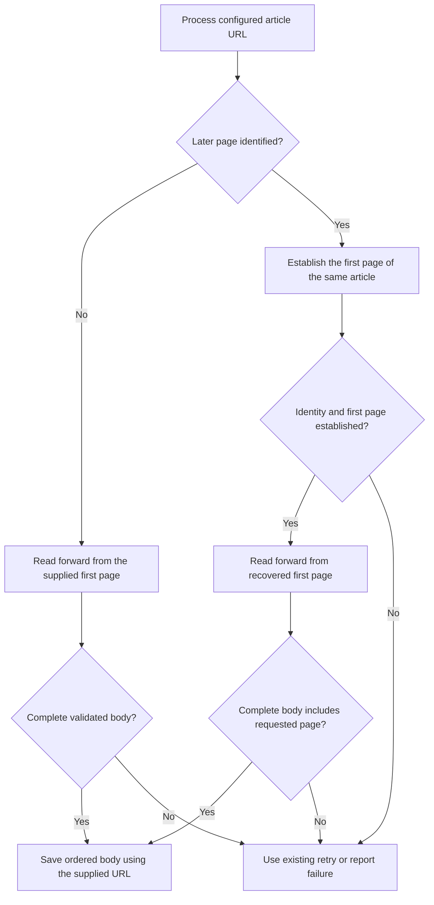

# Recover the first page of a configured article — spec
intent: 2026-10-24-pagination-first-page-recovery@e23184b
confirmed-behavior: 2026-10-25 @628e666
pre-build-review: required — Automatic backwards navigation changes the saved-content contract and must distinguish the same article from unrelated previous-article links.

## Requirements
REQ-1 — Complete the same article from a later entry
  WHEN a verified ITmedia, PRESIDENT, Yahoo or Toyokeizai later-page URL is processed with a matching pagination rule, the scraper shall obtain the same complete target body as a first-page entry. → Acceptance #1

REQ-2 — Preserve article order and uniqueness
  WHEN an article is recovered from a later-page entry, the scraper shall save its body starting from the first page in source-page order without combining any article page twice. → Acceptance #2

REQ-3 — Reject uncertain or incomplete recovery
  WHEN the scraper cannot establish the same article or obtain its complete body, the scraper shall report extraction failure without saving a partial body or login/challenge content as the article. → Acceptance #3

REQ-4 — Preserve established extraction and output behavior
  WHEN first-page extraction, an existing browser retry or a failed extraction with existing output is processed, the scraper shall preserve the existing first-page results, retry settings and failure-time file protection. → Acceptance #4

## Design decision
- user-decided — On 2026-10-24, “對” confirms recovering complete articles from later entries for configured sites, ordered unique output, conservative failure and preservation of existing behavior. The preceding restatement disclosed automatic PR publication and separate merge acceptance.
- user-decided — On 2026-10-25, “是” confirms the visible success, failure, retry, existing-file, batch, ordinary-extraction and empty/dry-run behavior read back at decision point ②.
- agent-decided — Reuse the reviewed pagination baseline at 9d0da2f without modifying its existing PR branch. The new intent changes a capability explicitly excluded by that earlier spec; its own confirmation and review evidence must describe recovery rather than rejection alone.
- agent-decided — Recover the first page before accumulating output, then use the existing forward extraction and per-page validation. Pages observed while resolving the entry are not appended to the final body; otherwise backwards traversal could duplicate or reverse article content.
- agent-decided — Limit recovery to a matching configured-pagination path. Use standard first/previous navigation and supported page-number representations grounded in the six real examples. Preserve the ordinary extraction path for sites without a rule; this is not general pagination discovery.
- agent-decided — A recovery target needs a verified same-article URL relationship: the same origin and stable article identity, with only supported pagination components changing. For the demonstrated query URLs the article path remains identical; for ITmedia the article path stem remains identical while its terminal numbered-page suffix changes. A generic previous-article link, cross-origin target, changed article identifier or incompatible canonical identity is not evidence of an earlier page of this article. Do not accept a target solely because its title looks similar or it carries a first/prev label.
- agent-decided — A supported explicit numeric page greater than one may nominate page one even without a backwards link; the Toyokeizai second-page observation has no such link. A nominated URL is only a candidate. Validate its actual document and same-article relationship, and require the recovered forward sequence to include the originally requested article page before accepting the result. A candidate that skips or never reaches the original entry cannot silently replace it.
- agent-decided — Missing or contradictory first-page evidence remains a failure. Repeated earlier-page targets, loops, exhausted limits, unusable content, navigation errors and an inconsistent article chain return no body. The effective max_pages value retains its existing nonpositive-value default of ten and limits the complete forward article sequence. Recovery has a separate navigation allowance bounded by that same effective value; its discovery visits do not consume the forward allowance. Each retry resets both allowances. Preserve per-page timeouts; add no configuration setting or unbounded search.
- agent-decided — Retain the existing browser fallback as the sole retry policy. An allowed headed retry restarts from the supplied URL and repeats recovery and complete validation. Preserve wrapped challenge identity so headed_on_block: false still suppresses that retry; no login, subscription or challenge bypass is introduced.
- agent-decided — Keep the originally supplied URL as the existing output identity and source reference. Recovery changes navigation and complete body contents, not filenames, index keys or output format. Failed attempts leave old content and summaries untouched; existing explicit reprocessing, overwrite, completed-item skipping and cached-content behavior remain unchanged. Existing notes are not automatically re-extracted.
- agent-decided — The complexity check selected a bounded addition to existing pagination rather than a new discovery framework. Rough estimates are 50–100 additional production lines and 80–150 test lines, with no new production module required; safety checks justify the added surface. Replace the unconditional later-entry rejection where safe recovery succeeds, while retaining rejection when it cannot be established.
- agent-decided — Use fresh isolated profiles, configs, outputs and executables for real comparisons; preserve the production executable, vault and running batch. Compare the six later entries with all source pages of their corresponding first-page articles, and retain the original twelve-article first-page corpus as regression coverage. Live restrictions or missing evidence must be reported, not counted as success.

## Alternatives considered
- Continue requiring the first-page URL: smaller, but does not deliver the newly confirmed capability.
- Rewrite every later-looking URL and trust the result: can select another article or an incomplete candidate, contrary to the correctness principles.
- Follow every first/previous link on the same website: previous-article navigation is common and does not establish article identity.
- Collect pages while moving backwards and prepend them: mixes discovery with final output and complicates ordering, duplication and retries.
- Add publisher-specific extractors or a general link crawler: unnecessary for the scoped examples and outside the confirmed automatic-discovery scope.

## Current state evidence
- Forward: internal/extract/pool.go :: `if selector, maxPages := MatchPaginationRule` routes configured articles through ExtractPaginated on both initial and headed attempts.
- Reverse: internal/pipeline/extraction.go :: `extractWithFallback` retries a returned failure and validates the combined body; internal/pipeline/runner.go :: `output.SHA8(item.URL)` and `URL: item.URL` retain the supplied URL as output identity and source.
- Error: internal/extract/browser.go :: `initial page advertises an earlier page` and `initial page number is greater than one` deliberately reject later entries today; internal/extract/pagination_entry_probe_test.go :: `TestPagination_laterentry_rejectsincomplete` permits failure or a complete article, never a successful suffix.
- Data: docs/loom/2026-10-24-reliable-itmedia-pagination/evidence/acceptance-test-evidence.md :: `Previously defective PRESIDENT2 and Toyokeizai2` and `ITmedia pages3/5, PRESIDENT3, Yahoo2` record the six verified later-entry URLs. ITmedia uses numbered path suffixes and standard previous metadata; PRESIDENT and Yahoo use a numeric page query. The separately captured Toyokeizai page-two observation in /private/tmp/rlss-accept-dom-toyokeizai/inspection.json has canonical page two and a forward link to page three without an earlier-page link.
- Boundary: internal/extract/browser.go :: `ValidateContent(content)` validates each page before internal/extract/pagination.go :: `pages = append(pages, content)`; that existing protection, complete-only walker, caller retry policy, output identity, source configuration and ordinary extraction remain the baseline. PRINCIPLES.md non-negotiables 1–3 prohibit substituting another article or access wall for missing target pages.

## UI flows
| Case | What the user does | What they see |
|---|---|---|
| Later-page success | Process one of the verified middle or final page URLs with a matching pagination rule | The saved body contains the complete same article from page one, in order without duplicate pages; the command reports Success 1 and exits 0. The supplied source URL and existing output naming remain intact. |
| First-page success | Process the corresponding first-page URL | The existing complete article result and success output remain unchanged. |
| In progress and retry | Process a recoverable article whose initial attempt fails | Existing processing and allowed retry messages remain visible. A permitted retry repeats the whole attempt and saves only the complete article. |
| Uncertain article or first page | Process an entry for which a same-article first page cannot be established | After the permitted retry, the command reports Failed 1 with the reason `cannot establish article first page` or `article identity mismatch`, exits nonzero and saves no partial article. Supply the actual first-page URL and retry. |
| Missing or unusable page | Process an article whose required page fails, is empty, or returns a recognized login/challenge page | Existing retry settings apply; final failure reports Failed 1 with the affected page and reason, exits nonzero and preserves old content and summaries. Retry when the actual article becomes accessible. |
| Loop or exhausted limit | Process an article whose recovery or full reading repeats pages or exceeds the configured limit | The command reports Failed 1 with the loop or limit reason and exits nonzero without partial output. Correct the rule or an intentionally insufficient limit, then retry. |
| Challenge retry disabled | Process a detected challenge when headed retry for challenges is disabled | It fails without opening a headed retry or saving the challenge as article content. Obtain legitimate access or change the user's own setting before rerunning. |
| Existing output | Explicitly reprocess a URL with existing output, or process an already completed item through the normal batch | Failed extraction preserves existing content and summaries. Complete success keeps existing overwrite behavior; completed batch items keep existing skip behavior. No automatic old-note migration occurs. |
| Batch or watch | Process a batch or watch cycle containing a failed recovery | Existing failure counts identify the failed item and processing continues for other items. A later attempt starts from the originally supplied URL. |
| No matching pagination rule | Process a site without a configured pagination rule | Existing ordinary extraction behavior remains unchanged; this feature does not discover pagination for that site. |
| Empty batch or dry run | Run an empty batch or the existing dry-run command | Existing empty/skipped output and exit behavior remain unchanged; no recovery or output writing occurs. |

Recovery accepts output only after the complete forward sequence includes the requested page and all page checks pass.

