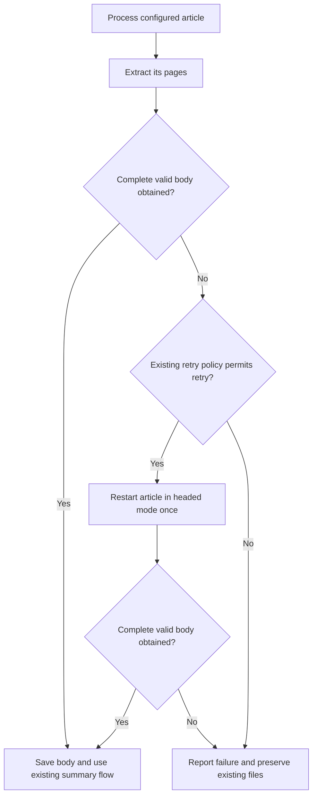

# Reliable ITmedia pagination — spec
intent: 2026-10-24-reliable-itmedia-pagination@c721bfb
confirmed-behavior: 2026-10-24 @8eb779e
pre-build-review: required — Changes the observable completion and saved-content contract of an existing extraction path.

## Requirements
REQ-1 — Complete the demonstrated ITmedia article
  WHEN the demonstrated five-page ITmedia article is processed with a matching pagination rule, the scraper shall obtain the target body from all five pages in order without merging a page twice. → Acceptance #1

REQ-2 — Do not present known incomplete extraction as success
  WHEN pagination is known to be incomplete, the scraper shall fail the extraction without saving or summarizing its partial body as a successful article. → Acceptance #2

REQ-3 — Preserve retries and working pagination
  WHEN configured pagination encounters a retryable failure, the scraper shall retain the existing browser retry and verification-page settings while preserving correct extraction of previously working news examples. → Acceptance #3

REQ-4 — Expand real-site evidence
  The verification evidence shall include additional real Japanese news pagination examples and record each article's observed page count, body checks and actual success or failure without treating access restrictions as successful verification. → Acceptance #4

## Design decision
- user-decided — On 2026-10-24, “好 但請同時收集更多案例” confirms the ITmedia fix and additional Japanese news examples. Automatic publication was disclosed at intent confirmation; merge requires separate acceptance.
- agent-decided — Correct the shared configured-pagination path rather than hard-code the demonstrated URL: the recorded partial-success bug resides in the common walker and can affect every configured site. Do not add automatic pagination discovery.
- agent-decided — A later-page error, empty/unusable page, known remaining continuation at the page cap, or repeated continuation is incomplete, not a normal last page. Return an error with the affected page/reason; never return the accumulated partial article as success. Principles Non-negotiables 1 and 3 settle this over retaining partial output.
- agent-decided — Investigate the full-load wait separately from body extraction and narrowly correct pagination navigation readiness. The independent live diagnostic obtained five pages while the unchanged CLI timed out on page two; readiness must retain navigation errors, bounded waits and content validation, not simply assume any visible body is the article.
- agent-decided — Keep the current caller's at-most-one headed retry and profile selection. A retry processes and validates the whole article; it must not append the failed attempt's partial pages. Preserve challenge classification so headed_on_block: false retains its effect.
- agent-decided — A missing configured next-link match alone cannot distinguish a final page from a broken selector. Detect demonstrated contradictory continuation evidence where available; otherwise do not claim general missing-page detection. Newly discovered unsupported site-specific behavior is reported, not silently expanded into a new extractor.
- agent-decided — Use isolated configs, profiles, executables and outputs for all live checks, with summarization and reading-list sources disabled. No new service, paid account, production configuration change, or existing-note migration is authorized.

## Alternatives considered
- Increase timeouts only: does not correct partial-success handling or prove article completion; the default-timeout ITmedia run already returned success after a later timeout.
- Return partial content with a warning: rejected by the confirmed correctness requirement and existing product principles.
- Automatically guess continuation on every website: outside the confirmed scope and introduces independent wrong-article risks.
- Add one special ITmedia URL exception: leaves the same demonstrated failure class in other configured articles.

## Current state evidence
- Forward: internal/extract/pool.go :: `if selector, maxPages := MatchPaginationRule` routes configured articles to the pagination entry for both initial and headed extraction.
- Reverse: internal/pipeline/extraction.go :: `extractWithFallback` retries only a returned failure; a partial body plus nil error bypasses retry and reaches output writing in internal/pipeline/runner.go :: `Write content file`.
- Error: internal/extract/pagination.go :: `return combined, nil` hides later-page errors, cap stops and repeated continuations; internal/extract/pagination_test.go :: `TestPaginate_FailSoftKeepsPriorPages` explicitly expects this behavior. The 2026-10-23 live log `/private/tmp/rlss-pagination-check/results/pcuser-default-timeouts-cli.log` records page two timing out after one gathered page, followed by Success 1 / Partial 0 / Failed 0.
- Data: internal/extract/pagination.go :: `pageFetcher` returns per-page body, next href and error; internal/config/config.go :: `NextPageSelector` / `MaxPages` and config.example.yaml :: `www.itmedia.co.jp` define the existing opt-in surface. The isolated prior diagnostic `/private/tmp/rlss-pagination-check/results/verification-summary.json` records seven publishers and 22 observed source pages; raw page text remains temporary, not committed.
- Boundary: internal/extract/browser.go :: `ExtractPaginated` currently waits through `chromedp.Navigate` before body visibility, whereas the isolated live diagnostic used direct navigation followed by body readiness. Pinned library semantics are grounded in github.com/chromedp/chromedp v0.15.1 nav.go and github.com/chromedp/cdproto's pinned page.Navigate implementation from go.mod; inspect these before altering the call. Ordinary single-page extraction, transcript/social adapters, production configuration and completed notes remain outside the requested new behavior.

## UI flows
| Case | What the user does | What they see |
|---|---|---|
| Complete configured article | Process the five-page ITmedia URL with the existing URL command and matching pagination rule | The saved body contains all five pages in order; the ordinary success report counts one article and the command exits 0. |
| In progress and recovery | Process a configured article whose initial extraction fails | Existing processing/retry messages remain visible; an allowed headed retry restarts the article and saves it only after complete extraction. |
| Later page fails or is unusable | Process a configured article whose later page cannot be obtained | After the existing permitted retry is exhausted, the report counts one failure, identifies the failed page/reason, and the single-URL command exits nonzero; no new partial content or summary replaces the article. Retry later when accessible. |
| Cap or loop with remaining continuation | Process a configured article whose next page would exceed its limit or repeat a page | Extraction reports an incomplete-pagination reason rather than success; the single-URL command exits nonzero after the permitted retry. Increase an intentionally low page limit or correct the rule, then rerun. |
| Verification page with retries disabled | Process an article blocked by a detected verification page with headed retry disabled for that condition | It fails without opening a headed retry or saving substitute content. Rerun after obtaining legitimate access or changing the user's own setting. |
| Batch/watch | Process a batch or watch cycle containing a failed paginated article | The existing report counts that article as failed and continues other items; the batch's existing exit conventions remain unchanged. A later attempt begins from the article URL. |
| Empty selection / dry run | Run an empty batch or the existing dry-run command | Existing empty/skipped output and exit behavior remain unchanged; no extraction or output writing occurs. |
| Existing files | Retry extraction when an output file already exists, or process an already completed item | Failed extraction leaves existing content and summaries untouched. Successful complete extraction retains existing overwrite behavior; completed items retain existing skip behavior. No migration or batch rewrite is introduced. |
| Expanded verification | Read the real-site verification report | Additional Japanese publishers and multiple ITmedia articles are listed with observed page counts, body checks and outcomes; blocked, failed and unverified cases are explicitly identified. |

